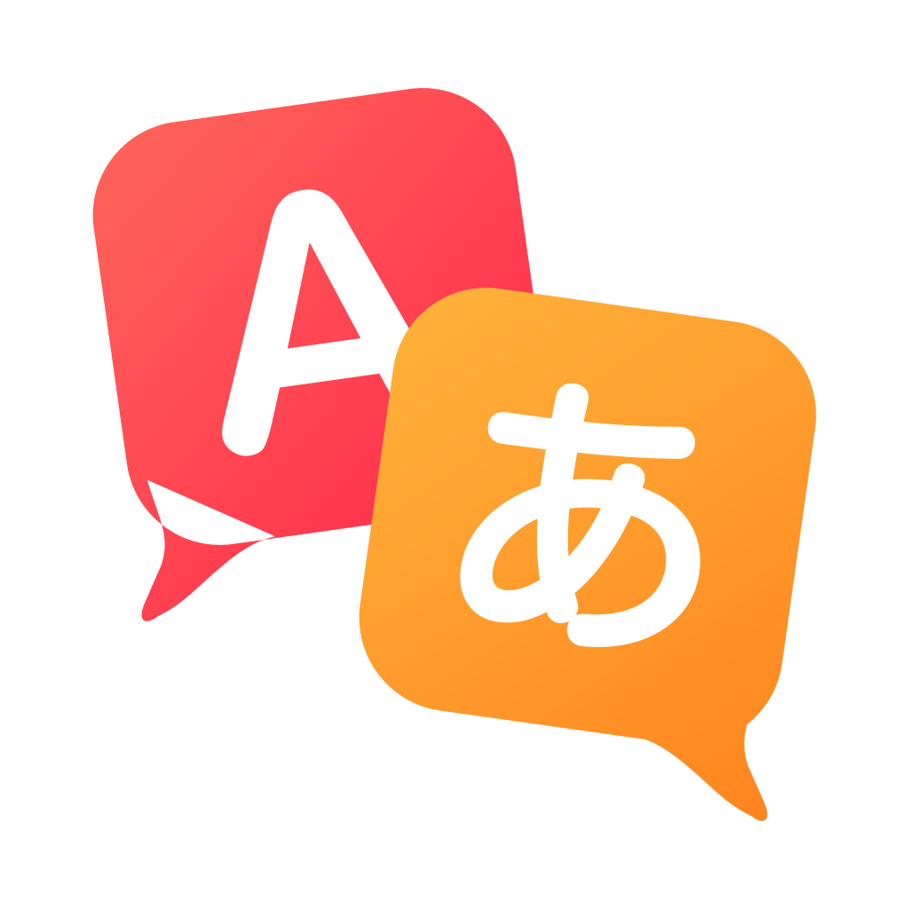

# Minecraft Java Mods

Minecraft: Java Edition の mod 集です（Kotlin、Forge / NeoForge / Fabric）。
Minecraft: Java Edition mods in Kotlin for Forge, NeoForge and Fabric.

紹介サイト / Website: https://aida0710.github.io/minecraft-java-mods/

| Mod | Minecraft | Loaders | 内容 / Description |
| --- | --- | --- | --- |
|  [Chat Translator](chat-translator/) | 26.3 | Forge, NeoForge, Fabric | チャット・アイテムの説明・本を翻訳し、自分の発言も翻訳して送れる。Translates chat, item tooltips and books, and sends your own messages translated. |

ダウンロード / Download: [Releases](https://github.com/aida0710/minecraft-java-mods/releases)

## フォルダの構成

| フォルダ | 中身 |
| --- | --- |
| `<mod>/` (例: `chat-translator/`) | mod ごとの Gradle プロジェクト。使い方と開発の手順はそれぞれの README |
| `site/` | 紹介サイト (GitHub Pages)。mod を足すときは `site/_mods/<mod>.md` を 1 つ足す ([site/README.md](site/README.md)) |
| `.github/workflows/` | `build.yml`: push のたびに mod を組み立てて jar を検査する。`pages.yml`: `site/` が変わったら紹介サイトを公開する |

mod を足すときは、新しいフォルダに Gradle プロジェクトを作り、`build.yml` に組み立ての手順を、`site/_mods/` に紹介ページを足します。

## ライセンス / License

[Apache License 2.0](LICENSE)。mod の jar に同梱しているライブラリのライセンスは、mod ごとの `licenses/` にあります (例: [chat-translator/licenses/THIRD-PARTY.txt](chat-translator/licenses/THIRD-PARTY.txt))。

Licensed under the [Apache License 2.0](LICENSE). Libraries bundled in each mod jar are listed in that mod's `licenses/` folder.

---

Minecraft is a trademark of Mojang. This project is not an official Minecraft product and is not approved by or associated with Mojang or Microsoft.
