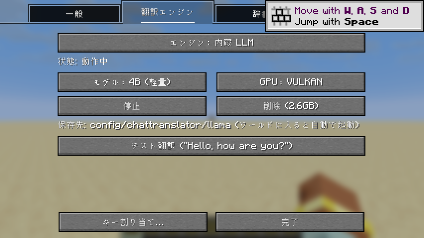

# Chat Translator (Minecraft 26.3 / Forge・NeoForge・Fabric / Kotlin)

受信チャットと**アイテムのツールチップ (名前・説明文)** を翻訳するクライアント専用 mod です。Hypixel SkyBlock での利用を想定していますが、どのサーバーでも使えます。

- 対応: Minecraft **26.3** / Java 25
  - Forge **66.0.x**
  - NeoForge **26.3.0.x**
  - Fabric (Fabric Loader 0.19.5 以降 + **Fabric API** が必要。[Mod Menu](https://modrinth.com/mod/modmenu) があれば mod 一覧から設定を開ける)
- 翻訳エンジン: **内蔵 LLM** (llama.cpp + TranslateGemma、設定画面からインストール) / OpenAI 互換 API (Ollama・LM Studio・OpenAI・Gemini など) / Claude API / DeepL API / Google 翻訳 API
- 翻訳の言語: 翻訳元・翻訳先を自由に選択 (日本語・英語・中国語・韓国語ほか約 30 言語、翻訳元は自動検出も可)
- mod の画面表示: **日本語 / English / 简体中文** (既定は Minecraft の言語設定に合わせる。「一般」タブの「mod の表示言語」で固定も可)
- 実装言語: Kotlin (標準ライブラリは jar に同梱済み。Kotlin for Forge や Fabric Language Kotlin は不要)




## 1. 導入

1. [Actions](https://github.com/aida0710/minecraft-forge-mods/actions) の最新ビルドの Artifact、または Release から、使うローダーの jar を取得
   - Forge: `chattranslator-forge-x.y.z.jar`
   - NeoForge: `chattranslator-neoforge-x.y.z.jar`
   - Fabric: `chattranslator-fabric-x.y.z.jar` (Fabric API も `mods/` に入れる)
2. `.minecraft/mods/` (Prism Launcher ならインスタンスの `mods/`) に配置して起動
3. ワールドかサーバーに入り、`/chattranslator` (または mod 一覧の「設定」) で設定画面を開く (タブは「一般 / 翻訳エンジン / 辞書 / キャッシュ / バックアップ」)
4. 「翻訳エンジン」タブで使うエンジンを選ぶ
   - **内蔵 LLM** (無料・オフライン): 「インストール」を押すと llama.cpp (Vulkan 版 約 30MB) と TranslateGemma 4B (約 2.5GB) をダウンロードします。どちらも SHA-256 で検証します
   - **クラウド API**: API キーを貼り付けて「テスト翻訳」で確認

内蔵 LLM はゲームの起動時には動かず、**ワールドやサーバーに入ったときに起動し、抜けると止まります**。ゲームが強制終了されても見張りプロセスが止めるので、VRAM を使ったままになりません。

### 翻訳エンジンの比較

| エンジン | 料金 | 速さ・品質 | メモ |
| --- | --- | --- | --- |
| 内蔵 LLM 4B | 無料 | 1 文 約 0.1 秒 (RTX 3080) | VRAM 4GB 程度。ゲーム用語の略語は誤訳しがち |
| 内蔵 LLM 12B | 無料 | 4B より高品質 | VRAM 8GB 以上推奨・約 7.3GB |
| Claude API (`claude-haiku-5-5`) | 従量課金 | 文脈やスラングに強い | `llmContext` でゲーム内の文だと伝えている |
| DeepL / Google | 従量課金 (無料枠あり) | 速い | スラングは苦手 |
| OpenAI 互換 | エンジン次第 | エンジン次第 | Ollama ならモデルが無いとき自動で `pull` |

クラウド API を選んだ場合、翻訳する文はそのサービスに送信されます。

## 2. 使い方

- **言語の選択**: 「一般」タブの翻訳元・翻訳先はドロップダウンで選びます。リストを開いて文字を打つと絞り込めます (例: `kor` → 한국어)
- **チャット** (表示方法は「一般」タブ)
  - `置き換え` (既定): 原文をいったん表示し、訳が届いた時点で同じ行を訳文に書き換えます。順序は崩れません
    - 行末の `[原文]` をクリックすると原文に戻り、`[訳]` で訳文に戻ります。訳文にカーソルを合わせても原文が見えます
  - `下に追加`: 原文の下に ` ⤷ 訳文` を表示
  - `[MVP+] Name: message` のような形式は名前部分を除いて本文だけ翻訳し、ランクや名前の色はそのまま
- **ツールチップ (アイテム説明)**: 同じ色で続く行を 1 段落にまとめて翻訳し、元の幅で折り返します。数値などの色は訳文でも維持
- **ショートカット** (設定画面の「キー割り当て…」、またはオプション > 操作 > Chat Translator)

  | 操作 | 既定のキー |
  | --- | --- |
  | ツールチップを原文表示 (押している間) | `J` |
  | ツールチップの原文表示 切り替え | 未割り当て |
  | チャット翻訳 ON/OFF | 未割り当て |
  | ツールチップ翻訳 ON/OFF | 未割り当て |
  | 設定画面を開く | 未割り当て |

  インベントリやチェストを開いたままでも効きます (切り替えはトーストで表示)

### コマンド

| コマンド | 内容 |
| --- | --- |
| `/chattranslator` (または `config`) | 設定画面を開く |
| `/chattranslator status` | エンジン・言語・キャッシュ・辞書の状態 |
| `/chattranslator test <文>` | 翻訳のテスト |
| `/chattranslator lang <翻訳元> <翻訳先>` | 言語の変更 (例: `lang en ja`、`lang auto zh-Hans`) |
| `/chattranslator keep add\|remove\|list <語>` | 翻訳しない語を登録・削除・一覧 |
| `/chattranslator term add "<原文>" <訳語>` / `term remove <原文>` | 決まった訳語を登録・削除 |
| `/chattranslator dict list\|on\|off\|reload [id]` | 辞書の一覧・有効化・無効化・再読み込み |
| `/chattranslator cache clear\|info` | キャッシュの削除・情報 |
| `/chattranslator pull` | 内蔵 LLM の再起動 (OpenAI 互換なら Ollama のモデルを pull) |
| `/chattranslator export [名前]` | 言語設定・辞書・キャッシュをエクスポート |
| `/chattranslator import <ファイル名>` | `config/chattranslator/exports` にあるファイルをインポート |

## 3. 辞書

`config/chattranslator/dictionaries/<id>.json` に置いた辞書を、設定画面の「辞書」タブで個別に ON/OFF できます。

- **Hypixel SkyBlock** (同梱・既定 ON): 公開 API から取得した SkyBlock の全アイテム名 (約 5,000 件)、地名、ボス名を英語のまま残し、ステータス行・レアリティ行・`Mana Cost` などを翻訳しません。mod の更新時に最新版で上書きされます
- **ユーザー辞書** (`user.json`): 設定画面の「ユーザー辞書を編集…」やコマンドで追加した語。上書きされません
- **自作の辞書**: 次の形式の JSON をフォルダに置いて「辞書を再読み込み」すれば一括で追加できます (有効にするには「辞書」タブで ON)

```json
{
  "name": "My server",
  "description": "サーバー固有の用語",
  "keep": ["Mayor Diana", "Crimson Isle"],
  "terms": { "gg": "おつかれ" },
  "skip": ["^\\s*Mana Cost: .*$"],
  "hypixelItems": false
}
```

| 項目 | 内容 |
| --- | --- |
| `keep` | 文中に出てきても翻訳せず原文のまま残す語 (固有名詞・地名など) |
| `terms` | 行 (段落) 全体が一致したときに使う訳語 |
| `skip` | この正規表現に一致する行は翻訳しない |
| `hypixelItems` | `true` なら Hypixel の全アイテム名も保護する |

保護する語は、翻訳の前に `ITEM1` のような記号に置き換え、訳した後で元に戻しています。翻訳エンジンが記号を崩した場合は、保護なしで訳し直します。

## 4. キャッシュ

一度訳した文はキャッシュに入り、次からはすぐ表示されます (「キャッシュ」タブ)。

- `ファイルに保存`: ON なら `config/chattranslator/cache.json` に保存して次回起動時も使う。OFF ならゲームを閉じると消える
- `最大件数`: 超えたら古いものから捨てる
- エンジン・モデル・言語を変えると、自動で別のキャッシュとして扱います

## 5. エクスポート / インポート

「バックアップ」タブ (またはコマンド) で、**言語設定・辞書・翻訳キャッシュ**を 1 つの JSON ファイルにまとめて書き出し、読み込めます。含める項目はタブで選べます。

- 保存先: `config/chattranslator/exports/chattranslator-<日時>.json`。別の PC のファイルは、このフォルダに置けば一覧に出ます
- **含めないもの**: API キー、翻訳エンジンの設定、同梱の Hypixel 辞書 (mod に入っているため)
- インポート時の動き
  - 言語設定 (翻訳元・翻訳先・mod の表示言語): ファイルの値に置き換える
  - 辞書: 有効な辞書の一覧はファイルの内容に置き換える。ユーザー辞書は今の内容に**追加**し、自作の辞書は同じ名前のファイルを**置き換える**
  - キャッシュ: 今のキャッシュに追加する (最大件数を超えたら古いものから捨てる)

## 6. 既知の制限

- 初めて見る文は、翻訳が終わるまで数秒間は原文のまま表示されます
- ツールチップの段落は「同じ色の行が続く」ことで判定しているため、まれに区切りがずれることがあります
- 表示言語を切り替えても、すでにチャット欄にある行は切り替え前の言語のままです (バニラと同じ仕様)
- 「mod の表示言語」を固定しても、操作設定画面 (キー割り当て) に出るキーの名前は Minecraft の言語のままです
- Fabric では、署名付きのプレイヤー発言 (Hypixel 以外のサーバーの通常のチャット) を表示前に書き換える手段が無いため、いったん原文で表示してから同じ行を訳文に置き換えます。Hypixel のメッセージはシステムメッセージなので、ほかのローダーと同じく表示前に置き換わります
- 4B モデルはゲーム内スラング (`f7` = フロア 7、`900m` = 9 億コイン など) を誤訳しがちです
- この mod はクライアント側の表示を変えるだけで、サーバーへ何かを送信することはありません。Hypixel のルール (Allowed Modifications) に照らしての利用可否はご自身で判断してください

## 開発

```powershell
cd chat-translator
./gradlew build                # 3 つのローダーの jar と単体テスト
./gradlew :forge:runClient     # 開発用クライアント起動 (:neoforge:runClient / :fabric:runClient も同様)
```

配布用の jar は `forge/build/libs/chattranslator-forge-<version>.jar` (NeoForge・Fabric も同じ形) です。Kotlin 標準ライブラリと設定ファイル用の NightConfig を同梱しています。

| フォルダ | 中身 |
| --- | --- |
| `common/` | 全ローダー共通のコード・画面の文字列・辞書・単体テスト。バニラの Minecraft に対してコンパイルするので、ローダー固有の API を使うとここで失敗します |
| `forge/` `neoforge/` `fabric/` | 各ローダーの入口 (イベントを `ChatTranslator` に渡すだけ) と mod 情報ファイル。common のソースを取り込んで 1 つの jar にします |
| `gradle/loader.gradle` | 3 つのローダーで共通のビルド設定 (common の取り込み、ライブラリの同梱) |

JDK 25 は Gradle (foojay) が自動で取得し、Gradle 自体もその JDK 25 で動きます (`gradle/gradle-daemon-jvm.properties`)。Gradle の起動自体には Java 17 以上が必要です。

画面の文字列は `common/src/main/resources/assets/chattranslator/lang/` の `en_us.json` / `ja_jp.json` / `zh_cn.json` にあります。`LangFilesTest` が、コードで使っているキーがすべての言語にあるかを確認します。

### 自動テスト (開発者向け)

`-Pselftest=<dir>` を付けて起動すると、`<dir>/commands.txt` に追記したコマンドを実行し `[SELFTEST]` としてログに出します。

```powershell
./gradlew :forge:runClient -Pselftest="$PWD/run/selftest"   # :neoforge:runClient / :fabric:runClient も同様
# 別ターミナルで
echo "world selftest" >> run/selftest/commands.txt              # 新規ワールドを作成して入る
echo "inject §b[MVP§c+§b] Steve§f: hello there" >> run/selftest/commands.txt   # サーバーからのメッセージを再現
echo "dump 5" >> run/selftest/commands.txt                       # チャット内容をログ出力
echo "tooltip" >> run/selftest/commands.txt                      # SkyBlock 風アイテムのツールチップ翻訳を確認
echo "settings 1" >> run/selftest/commands.txt                   # 設定画面 (2 番目のタブ) を開く
echo "uilang zh_cn" >> run/selftest/commands.txt                 # 表示言語を切り替える
echo "screenshot test" >> run/selftest/commands.txt              # forge/run/screenshots/test.png (ローダーごとの run フォルダ)
```
