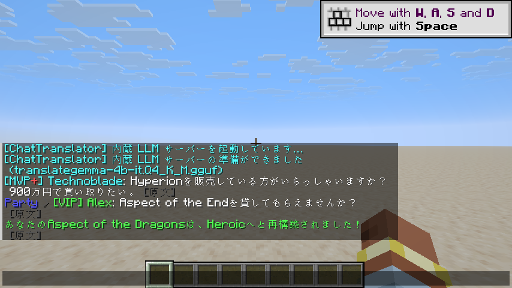

# Chat Translator (Forge 26.3 / Kotlin)

ローカル LLM を使って、受信チャットと**アイテムのツールチップ (名前・説明文)** を英語→日本語に翻訳するクライアント専用 mod です。
Hypixel SkyBlock での利用を想定しています。

- 対応: Minecraft **26.3** / Forge **66.0.x** / Java 25
- 実装言語: Kotlin (標準ライブラリは jar に同梱済み。Kotlin for Forge は不要)
- **mod を入れるだけで動きます**: 翻訳エンジン (llama.cpp) と翻訳モデルを初回起動時に自動でダウンロードし、ゲーム起動中だけ裏で動かします



## 1. 導入

1. [Actions](https://github.com/aida0710/minecraft-forge-mods/actions) の最新ビルドの Artifact、または Release から `chattranslator-x.y.z.jar` を取得
2. `.minecraft/mods/` (Prism Launcher ならインスタンスの `mods/`) に配置して起動
3. 初回のみ以下を自動でダウンロードします (進捗はワールド参加後に画面下部に表示)
   - llama.cpp の `llama-server` (Vulkan 版 約 30MB) — GitHub Releases から
   - 翻訳特化モデル **TranslateGemma 4B** (GGUF Q4_K_M, 約 2.5GB, SHA-256 検証あり) — Hugging Face から
4. 「内蔵 LLM サーバーの準備ができました」と出たら翻訳が始まります。2 回目以降は数秒で起動します

ファイルは `config/chattranslator/llama/` に保存されます。ゲームを終了すると翻訳サーバーも止まります (強制終了した場合も見張りプロセスが止めます)。

### 動作環境の目安

- GPU: VRAM 4GB 程度の空きがあれば快適 (RTX 3080 で 1 文あたり約 0.1 秒)。GPU が無い場合は `builtin.gpu = "CPU"` (遅くなります)
- NVIDIA で最速にしたい場合は `builtin.gpu = "CUDA"` (追加で約 580MB ダウンロード)

### 設定 (`config/chattranslator-client.toml`)

| キー | 既定値 | 内容 |
| --- | --- | --- |
| `backend.mode` | `BUILTIN` | `BUILTIN`: 上記の自動導入 / `EXTERNAL`: 自分で立てたサーバー (Ollama, LM Studio など) を使う |
| `builtin.gpu` | `VULKAN` | `VULKAN` / `CUDA` / `CUDA12` / `CPU` (macOS は常に Metal) |
| `builtin.modelUrl` | TranslateGemma 4B | 別の GGUF を使う場合に変更 (12B 版は高品質だが VRAM 8GB 以上必要)。変更時は `modelSha256` を空にするか正しい値に |
| `chat.displayMode` | `REPLACE` | `REPLACE`: 原文を訳文に置き換え / `APPEND`: 下に追加 |
| `tooltip.translateItemName` | `true` | アイテム名も訳すか (固有名詞は直訳されがちなので、気になる場合は `false`) |

### 外部サーバーを使う場合 (`backend.mode = "EXTERNAL"`)

OpenAI 互換 API (`/v1/chat/completions`) を持つものなら何でも使えます。`[external]` の `endpoint` と `model` を設定してください。
Ollama の場合は、モデルが無ければ mod が自動で `pull` します (`external.autoPull`)。

| サーバー | endpoint |
| --- | --- |
| Ollama (`translategemma:4b` など) | `http://localhost:11434/v1` |
| LM Studio | `http://localhost:1234/v1` |
| llama.cpp / llama-cpp-python | `http://localhost:8080/v1` |

## 2. 使い方

- チャット (`chat.displayMode`)
  - `REPLACE` (デフォルト): 原文をいったん表示し、訳が届いた時点で**同じ行を訳文に書き換えます** (順序は崩れません)
    - 行末の **`[原文]`** をクリックすると原文に戻り、**`[訳]`** で再び訳文に切り替わります
    - 訳文にカーソルを合わせると原文がツールチップで表示されます
    - 複数行のメッセージは装飾が崩れないよう下に訳文を追加表示します
  - `APPEND`: 原文の下に ` ⤷ 訳文` を灰色で追加表示します
  - `[MVP+] Name: message` のような形式は名前部分を除いて本文だけ翻訳します
  - Hypixel はプレイヤー発言もシステムメッセージとして送るので、`chat.translateSystemMessages = false` にするとほぼ何も翻訳されなくなります。不要なメッセージは glossary.json の `skip` で除外してください
- ツールチップ: アイテムにカーソルを合わせると、未翻訳の行は裏で翻訳が始まり、完了次第訳文に切り替わります
  - 一度訳した文は `config/chattranslator/cache.json` に保存され、次回から即時表示
- アイテム名 (`skyblock.protectItemNames`, 既定 ON)
  - Hypixel の公開 API から SkyBlock の全アイテム名 (約 5,000 件) を取得し、**アイテム名は英語のまま**残します (wiki やオークションで検索できるように)
  - ツールチップの 1 行目が既知のアイテム (`Heroic Hyperion ✪✪✪` や `[Lvl 100] Golden Dragon` も判定) なら翻訳しません。メニューのボタン名など、アイテム以外の名前は翻訳されます
  - チャットや説明文の中のアイテム名も英語で残ります (例: `anyone selling a hyperion?` → `Hyperionを販売している方がいらっしゃいますか？`)。小文字で打たれた名前にも対応
- キー操作 (設定 > 操作 で変更可)
  - `J` (押している間): ツールチップを原文表示に戻す (インベントリを開いたまま使えます)
  - 未割当: チャット翻訳 ON/OFF、ツールチップ翻訳 ON/OFF (インベントリを閉じた状態で押す)
- クライアントコマンド
  - `/chattranslator status` — 状態表示 (モデルの準備状況を含む)
  - `/chattranslator test <英文>` — LLM との接続テスト
  - `/chattranslator pull` — 翻訳サーバーを再起動 (足りないファイルがあれば再ダウンロード。外部モードでは Ollama のモデルを pull)
  - `/chattranslator reload` — glossary.json の再読み込み
  - `/chattranslator clearcache` — 翻訳キャッシュを削除

## 3. 辞書 (glossary.json)

```json
{
  "terms": {
    "Hyperion": "Hyperion",
    "Click to view!": "クリックして表示！"
  },
  "skip": [
    "^\\s*(Damage|Strength|Defense): .*$"
  ]
}
```

- `terms`: 行全体が完全一致したら LLM を使わずこの訳を使う。**値を原文と同じにすると翻訳しない** (SkyBlock のアイテム名は自動で保護されるので登録不要)
- `skip`: 正規表現にマッチする行は翻訳しない (ステータス行やレアリティ行など)

## 4. 既知の制限

- **アイテム説明文の翻訳は可能ですが**、以下の制約があります
  - 初めて見る行は最初の数秒は英語のまま (LLM の応答待ち)。キャッシュに入れば以降は即時
  - 1 行の中で色が混在している場合、訳文は本文先頭の色 1 色になります (チャットのランク・名前部分の色は保持)
  - 行単位の翻訳なので、複数行にまたがる文は不自然になることがあります
  - ステータス値など数値が頻繁に変わる行はキャッシュが効きにくいため、`skip` で除外するのがおすすめ
- `REPLACE` モードでは、翻訳が届くまでの数秒間は原文が表示されます。チャット欄を開いてスクロールしている最中に書き換わると表示位置が少しずれることがあります
- 4B モデルなのでゲーム内スラング (`f7` = フロア 7、`900m` = 9 億コイン など) は誤訳しがちです。気になる場合は 12B モデルや glossary を利用してください
- この mod はクライアント側の表示を変えるだけで、サーバーへ何かを送信することはありません。Hypixel のルール (Allowed Modifications) に照らしての利用可否はご自身で判断してください

## 開発

```powershell
cd chat-translator
./gradlew build       # build/libs/chattranslator-<version>.jar が配布用 (Kotlin 同梱)
./gradlew runClient   # 開発用クライアント起動
```

JDK 25 は Gradle (foojay) が自動で取得します。Gradle の起動自体には Java 17 以上が必要です。

### 自動テスト (開発者向け)

`-Pselftest=<dir>` を付けて起動すると、`<dir>/commands.txt` に追記したコマンドを実行し `[SELFTEST]` としてログに出します。

```powershell
./gradlew runClient -Pselftest="$PWD/run/selftest"
# 別ターミナルで
echo "world selftest" >> run/selftest/commands.txt              # 新規ワールドを作成して入る
echo "inject §b[MVP§c+§b] Steve§f: hello there" >> run/selftest/commands.txt   # サーバーからのメッセージを再現
echo "dump 5" >> run/selftest/commands.txt                       # チャット内容をログ出力
echo "tooltip" >> run/selftest/commands.txt                      # SkyBlock 風アイテムのツールチップ翻訳を確認
echo "screenshot test" >> run/selftest/commands.txt              # run/screenshots/test.png
```
