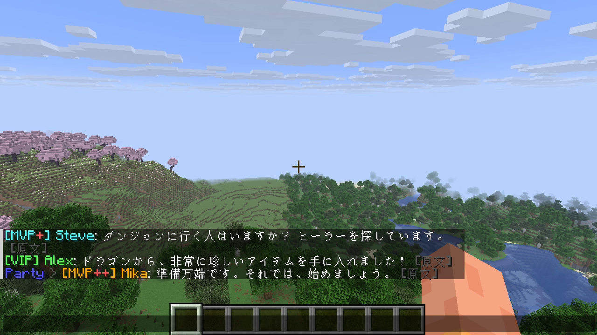
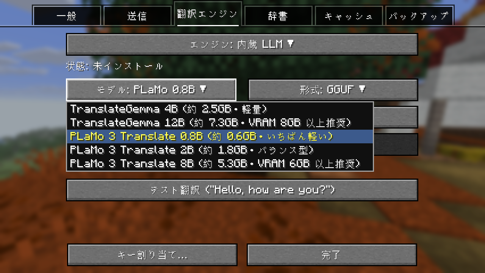

# Chat Translator (Minecraft 26.3 / Forge・NeoForge・Fabric / Kotlin)

受信チャット・**アイテムのツールチップ (名前・説明文)**・**本**を翻訳し、**自分が送るチャットも翻訳して送れる**クライアント専用 mod です。Hypixel SkyBlock での利用を想定していますが、どのサーバーでも使えます。

- 対応: Minecraft **26.3** / Java 25
  - Forge **66.0.x**
  - NeoForge **26.3.0.x**
  - Fabric (Fabric Loader 0.19.5 以降 + **Fabric API** が必要。[Mod Menu](https://modrinth.com/mod/modmenu) があれば mod 一覧から設定を開ける)
- 翻訳エンジン: **内蔵 LLM** (TranslateGemma または PLaMo 3 Translate、設定画面からインストール) / OpenAI 互換 API (Ollama・LM Studio・OpenAI・Gemini など) / Claude API / DeepL API / Google 翻訳 API
- 内蔵 LLM が動く OS: Windows / macOS (Apple silicon・Intel) / Linux
- 翻訳の言語: 翻訳元・翻訳先を自由に選択 (日本語・英語・中国語・韓国語ほか約 30 言語、翻訳元は自動検出も可)
- mod の画面表示: **日本語 / English / 简体中文** (既定は Minecraft の言語設定に合わせる。「一般」タブの「mod の表示言語」で固定も可)
- 実装言語: Kotlin (標準ライブラリは jar に同梱済み。Kotlin for Forge や Fabric Language Kotlin は不要)





## 1. 導入

1. [Releases](https://github.com/aida0710/minecraft-java-mods/releases) から、使うローダーの jar を取得 (紹介ページ: https://aida0710.github.io/minecraft-java-mods/chat-translator/)
   - Forge: `chattranslator-forge-x.y.z.jar`
   - NeoForge: `chattranslator-neoforge-x.y.z.jar`
   - Fabric: `chattranslator-fabric-x.y.z.jar` (Fabric API も `mods/` に入れる)
2. `.minecraft/mods/` (Prism Launcher ならインスタンスの `mods/`) に配置して起動
3. ワールドかサーバーに入り、`/chattranslator` (または mod 一覧の「設定」) で設定画面を開く (タブは「一般 / 送信 / 翻訳エンジン / 辞書 / キャッシュ / バックアップ」)
4. 「翻訳エンジン」タブで使うエンジンを選ぶ
   - **内蔵 LLM** (無料・オフライン): モデルと形式を選んで「インストール」を押すと、推論サーバーとモデルをダウンロードします。既定は llama.cpp (Vulkan 版 約 30MB) と PLaMo 3 Translate 0.8B (約 0.6GB) です。ダウンロードしたものは SHA-256 やコミットの固定で検証します ([内蔵 LLM のモデルと形式](#内蔵-llm-のモデルと形式))
   - **クラウド API**: API キーを貼り付けて「テスト翻訳」で確認

内蔵 LLM はゲームの起動時には動かず、**ワールドやサーバーに入ったときに起動し、抜けると止まります**。ゲームが強制終了されても見張りプロセスが止めるので、VRAM を使ったままになりません。

### 内蔵 LLM のモデルと形式

「翻訳エンジン」タブの「モデル」と「形式」で選びます。迷ったら **形式は GGUF** のままで十分です。

| モデル | GGUF の大きさ | メモ |
| --- | --- | --- |
| TranslateGemma 4B | 約 2.5GB | VRAM 4GB 程度 |
| TranslateGemma 12B | 約 7.3GB | VRAM 8GB 以上推奨 |
| PLaMo 3 Translate 0.8B | 約 0.6GB | 既定。いちばん軽い。CPU でも 1 文 0.2 秒ほど (Xeon 16 スレッド) |
| PLaMo 3 Translate 2B | 約 1.8GB | 軽さと品質のバランスがよい |
| PLaMo 3 Translate 8B | 約 5.3GB | VRAM 6GB 以上推奨 |

PLaMo 3 Translate は翻訳元の自動検出に対応します (TranslateGemma は英語として扱います)。ポルトガル語・スウェーデン語・デンマーク語・フィンランド語・ノルウェー語・チェコ語・ルーマニア語・トルコ語・ウクライナ語・ギリシャ語には対応しないので、これらを使うときは TranslateGemma を選んでください。

| 形式 | 推論サーバー | 動く環境 | 追加のダウンロード |
| --- | --- | --- | --- |
| GGUF (Q4_K_M) | llama.cpp | すべて。Windows・Linux は Vulkan / CUDA / CPU、macOS は Metal / CPU | 約 30MB〜 |
| MLX 4bit | mlx-lm | Apple silicon の macOS | 約 0.5GB |
| FP8 | vLLM | NVIDIA GPU の Linux と、Windows の WSL2 | 約 9.5GB |
| NVFP4 | vLLM | RTX 50 シリーズの Linux と、Windows の WSL2 | 約 9.5GB |

- **RTX 50 シリーズの Windows** でも、まずは GGUF をおすすめします。PLaMo 8B なら GGUF は 5.3GB、NVFP4 は 6.1GB で、PFN の評価でも精度に大きな差はありません。llama.cpp はそのまま Windows で動きますが、vLLM は Windows に対応していないため WSL2 が必要で、起動にも 1 分以上かかります
- **FP8・NVFP4 を Windows で使う**には、先に WSL2 を入れておきます。PowerShell で `wsl --install` を実行して再起動すると Ubuntu が入り、NVIDIA のドライバーはそのまま WSL2 から使えます。Python 環境は WSL2 の中の `~/.local/share/chattranslator` に置き、「削除」でまとめて消します
- FP8 は RTX 40 シリーズ以降で本来の速さになります。それより古い GPU では重みだけ FP8 のまま動きます。NVFP4 は RTX 50 シリーズ向けで、古い GPU では起動に失敗することがあります (RTX 3080 Ti では失敗しました)
- TranslateGemma の MLX・FP8・NVFP4 は、Google ではなくコミュニティが変換したものです (mlx-community、kaitchup)。FP8・NVFP4 は変換者も簡単な確認しかしていないと書いています
- **動作を確かめていないもの**: RTX 50 シリーズでの NVFP4、RTX 40 シリーズ以降での FP8 本来の動き、WSL2 の中で GPU を使って vLLM を動かすこと、TranslateGemma の FP8・NVFP4 の翻訳、Mac の実機 (macOS の確認は GitHub Actions の仮想環境で行いました)
- mlx-lm と vLLM は Python で動きます。Python を入れておく必要はありません (mod が [uv](https://github.com/astral-sh/uv) を取得して環境を作ります)。パッケージは jar に入れた一覧で版と SHA-256 を固定し、PLaMo の中で動く Python コードはコミットを固定して取得します

### 翻訳エンジンの比較

| エンジン | 料金 | 速さ・品質 | メモ |
| --- | --- | --- | --- |
| 内蔵 LLM PLaMo 3 Translate | 無料 | 1 文 約 0.03〜0.05 秒 (0.8B、RTX 3080 Ti、CUDA)。PFN の評価では 2B で TranslateGemma の全サイズを上回る | 既定は 0.8B (約 0.6GB、VRAM も約 0.6GB)。一部の言語は未対応 |
| 内蔵 LLM TranslateGemma 4B | 無料 | 1 文 約 0.1 秒 (RTX 3080) | VRAM 4GB 程度。ゲーム用語の略語は誤訳しがち |
| 内蔵 LLM TranslateGemma 12B | 無料 | 4B より高品質 | VRAM 8GB 以上推奨・約 7.3GB |
| Claude API (`claude-haiku-5-5`) | 従量課金 | 文脈やスラングに強い | `llmContext` でゲーム内の文だと伝えている |
| DeepL / Google | 従量課金 (無料枠あり) | 速い | スラングは苦手 |
| OpenAI 互換 | エンジン次第 | エンジン次第 | Ollama ならモデルが無いとき自動で `pull` |

クラウド API を選んだ場合、翻訳する文はそのサービスに送信されます。

## 2. 使い方

- **言語の選択**: 「一般」タブの翻訳元・翻訳先はドロップダウンで選びます。リストを開いて文字を打つと絞り込めます (例: `kor` → 한국어)
- **チャット** (表示方法は「一般」タブ)
  - `置き換え` (既定): 原文をいったん表示し、訳が届いた時点で同じ行を訳文に書き換えます。順序は崩れません
    - 行末の `[原文]` をクリックすると原文に戻り、`[訳]` で訳文に戻ります。訳文にカーソルを合わせても原文が見えます
  - `下に追加`: 原文の下に ` ⤷ 訳文` を表示
  - `[MVP+] Name: message` や `<Name> message` のような形式は名前部分を除いて本文だけ翻訳し、ランクや名前の色はそのまま
  - 自分が翻訳して送った発言がサーバーから戻ってきても、訳し戻しません
- **ツールチップ (アイテム説明)**: 同じ色で続く行を 1 段落にまとめて翻訳し、元の幅で折り返します。数値などの色は訳文でも維持
- **本** (記入済みの本・書見台、「一般」タブの「本の翻訳」): 開いているページから順に翻訳し、訳が揃ったページから訳文に変わります。`J` を押している間は原文。クリックできる文字を含むページ (サーバーのメニューなど) は動作を壊さないよう原文のままです
- **送信するチャット** (「送信」タブ。既定は OFF)
  - チャット入力欄で Enter を押すと、書いた文を翻訳します (既定: 日本語 → English)
  - `送る前に確認` が ON (既定) なら訳文が入力欄に入るので、確かめてもう一度 Enter で送ります。OFF なら翻訳してすぐ送ります
  - `送る形`: 訳文だけ / `訳文 (原文)`
  - `/` で始まるコマンドは「翻訳するコマンド」の一覧にあるものだけ本文を翻訳します。既定は Hypixel のチャット用の `pc` `gc` `oc` `ac` `shout` `r` と、宛先を残す `msg 1` `w 1` `tell 1` `whisper 1` (`/msg Steve こんにちは` なら `Steve` は残して `こんにちは` だけ訳す)
  - すでに翻訳先の言語で書かれた文 (`gg` など) はそのまま送ります。翻訳に失敗したときは、もう一度 Enter を押すと原文のまま送れます
- **ショートカット** (設定画面の「キー割り当て…」、またはオプション > 操作 > Chat Translator)

  | 操作 | 既定のキー |
  | --- | --- |
  | ツールチップを原文表示 (押している間) | `J` |
  | ツールチップの原文表示 切り替え | 未割り当て |
  | チャット翻訳 ON/OFF | 未割り当て |
  | ツールチップ翻訳 ON/OFF | 未割り当て |
  | 送信チャットの翻訳 ON/OFF | 未割り当て |
  | 設定画面を開く | 未割り当て |

  インベントリやチェストを開いたままでも効きます (切り替えはトーストで表示)

### コマンド

| コマンド | 内容 |
| --- | --- |
| `/chattranslator` (または `config` / `settings`) | 設定画面を開く |
| `/chattranslator status` | エンジン・言語・キャッシュ・辞書・送信の翻訳の状態 |
| `/chattranslator toggle chat\|tooltip\|book\|send` | 機能の ON/OFF を切り替える (チャット・ツールチップ・本・送信するチャット) |
| `/chattranslator test <文>` | 翻訳のテスト |
| `/chattranslator lang <翻訳元> <翻訳先>` | 言語の変更 (例: `lang en ja`、`lang auto zh-Hans`) |
| `/chattranslator send lang <書く言語> <送る言語>` | 送信するチャットの言語の変更 (例: `send lang ja en`) |
| `/chattranslator keep add\|remove\|list <語>` | 翻訳しない語を登録・削除・一覧 |
| `/chattranslator term add "<原文>" <訳語>` / `term remove <原文>` | 決まった訳語を登録・削除 |
| `/chattranslator dict list\|on\|off\|reload [id]` | 辞書の一覧・有効化・無効化・再読み込み |
| `/chattranslator cache clear\|info` | キャッシュの削除・情報 |
| `/chattranslator pull` | 内蔵 LLM の再起動 (OpenAI 互換なら Ollama のモデルを pull) |
| `/chattranslator export [名前]` | 言語設定・辞書・キャッシュをエクスポート |
| `/chattranslator import <ファイル名>` | `config/chattranslator/exports` にあるファイルをインポート |

## 3. 辞書

`config/chattranslator/dictionaries/<id>.json` に置いた辞書を、設定画面の「辞書」タブで個別に ON/OFF できます。

- **Hypixel SkyBlock** (同梱・既定 ON): 公開 API から取得した SkyBlock の全アイテム名 (約 5,000 件)、地名、ボス名を英語のまま残し、ステータス行・レアリティ行・`Mana Cost` などを翻訳しません。mod の更新時に最新版で上書きされます
- **ユーザー辞書** (`user.json`): 設定画面の「ユーザー辞書を編集…」やコマンドで追加した語。上書きされません
- **自作の辞書**: 次の形式の JSON をフォルダに置いて「辞書を再読み込み」すれば一括で追加できます (有効にするには「辞書」タブで ON)

```json
{
  "name": "My server",
  "description": "サーバー固有の用語",
  "keep": ["Mayor Diana", "Crimson Isle"],
  "terms": { "gg": "おつかれ" },
  "skip": ["^\\s*Mana Cost: .*$"],
  "hypixelItems": false
}
```

| 項目 | 内容 |
| --- | --- |
| `keep` | 文中に出てきても翻訳せず原文のまま残す語 (固有名詞・地名など) |
| `terms` | 行 (段落) 全体が一致したときに使う訳語 |
| `skip` | この正規表現に一致する行は翻訳しない |
| `hypixelItems` | `true` なら Hypixel の全アイテム名も保護する |

保護する語は、翻訳の前に `ITEM1` のような記号に置き換え、訳した後で元に戻しています。翻訳エンジンが記号を崩した場合は、保護なしで訳し直します。

## 4. キャッシュ

一度訳した文はキャッシュに入り、次からはすぐ表示されます (「キャッシュ」タブ)。

- `ファイルに保存`: ON なら `config/chattranslator/cache.json` に保存して次回起動時も使う。OFF ならゲームを閉じると消える
- `最大件数`: 超えたら古いものから捨てる
- エンジン・モデル・言語を変えると、自動で別のキャッシュとして扱います

## 5. エクスポート / インポート

「バックアップ」タブ (またはコマンド) で、**言語設定・辞書・翻訳キャッシュ**を 1 つの JSON ファイルにまとめて書き出し、読み込めます。含める項目はタブで選べます。

- 保存先: `config/chattranslator/exports/chattranslator-<日時>.json`。別の PC のファイルは、このフォルダに置けば一覧に出ます
- **含めないもの**: API キー、翻訳エンジンの設定、同梱の Hypixel 辞書 (mod に入っているため)
- インポート時の動き
  - 言語設定 (翻訳元・翻訳先・mod の表示言語): ファイルの値に置き換える
  - 辞書: 有効な辞書の一覧はファイルの内容に置き換える。ユーザー辞書は今の内容に**追加**し、自作の辞書は同じ名前のファイルを**置き換える**
  - キャッシュ: 今のキャッシュに追加する (最大件数を超えたら古いものから捨てる)

## 6. 既知の制限

- 初めて見る文は、翻訳が終わるまで数秒間は原文のまま表示されます
- 設定ファイル (`config/chattranslator-client.toml`) は起動時に 1 回だけ読みます。ゲーム中に直接書き換えても反映されず、その後に設定画面で何か変えるとファイルは上書きされます。手で編集するときはゲームを閉じてから行ってください
- ツールチップの段落は「同じ色の行が続く」ことで判定しているため、まれに区切りがずれることがあります
- 表示言語を切り替えても、すでにチャット欄にある行は切り替え前の言語のままです (バニラと同じ仕様)
- 「mod の表示言語」を固定しても、操作設定画面 (キー割り当て) に出るキーの名前は Minecraft の言語のままです
- Fabric では、署名付きのプレイヤー発言 (Hypixel 以外のサーバーの通常のチャット) を表示前に書き換える手段が無いため、いったん原文で表示してから同じ行を訳文に置き換えます。Hypixel のメッセージはシステムメッセージなので、ほかのローダーと同じく表示前に置き換わります
- TranslateGemma 4B はゲーム内スラング (`f7` = フロア 7、`900m` = 9 億コイン など) を誤訳しがちです
- 内蔵 LLM の起動中は、ゲームと同じ GPU のメモリを使います。vLLM はモデルが動くだけの割合を確保しますが、VRAM に余裕が無いと起動に失敗します (理由は設定画面と `config/chattranslator/llama/server.log` に出ます)
- 送信するチャットの翻訳を ON にした場合を除き、この mod はクライアント側の表示を変えるだけで、サーバーへ何かを送信することはありません。送信の翻訳も、自分が Enter を押した発言の中身を訳文に変えるだけです。Hypixel のルール (Allowed Modifications) に照らしての利用可否はご自身で判断してください

## ライセンス

[Apache License 2.0](../LICENSE)。jar には次のライブラリを同梱しています (詳しくは [licenses/THIRD-PARTY.txt](licenses/THIRD-PARTY.txt)。jar の中では `META-INF/licenses/`)。

- Kotlin 標準ライブラリ: Apache License 2.0
- NightConfig (設定ファイルの読み書き): GNU LGPL v3.0 ([licenses/LGPL-3.0.txt](licenses/LGPL-3.0.txt)。LGPL は [GPL v3.0](licenses/GPL-3.0.txt) に条件を足したもの)

内蔵 LLM の推論サーバーとモデルは jar に入っておらず、設定画面で「インストール」を押したときにダウンロードします。

- llama.cpp (MIT License)、mlx-lm (MIT License)、vLLM (Apache License 2.0)、uv (Apache License 2.0 / MIT License)
- TranslateGemma: Gemma の利用規約
- PLaMo 3 Translate: **Built with PLaMo**。PLaMo Community License ([日本語](licenses/PLaMo-Community-License-ja.txt) / [English](licenses/PLaMo-Community-License-en.txt))。個人の趣味などの利用は無償です。商用で使うときは[登録フォーム](https://forms.gle/mTL8tBLrMYXKNZD56)での事前登録が必要で、収入または売上が 10 億円を超える場合は別途契約が必要です。訳文を公表するときは PLaMo の生成物であることを明示する決まり (第 5 条) があるので、送信するチャットの翻訳で使うときは「訳文 (原文)」の形にするなど、ご自身で判断してください

## 開発

```powershell
cd chat-translator
./gradlew build                # 3 つのローダーの jar と単体テスト
./gradlew :forge:runClient     # 開発用クライアント起動 (:neoforge:runClient / :fabric:runClient も同様)
```

配布用の jar は `forge/build/libs/chattranslator-forge-<version>.jar` (NeoForge・Fabric も同じ形) です。Kotlin 標準ライブラリと設定ファイル用の NightConfig を同梱しています。

### 公開の手順

1. `gradle.properties` の `mod_version` を上げ、`release-notes/<版>.md` に公開する版の説明を書く。紹介サイトの `site/_mods/chat-translator.md` の `version` も同じ版にする
2. main に取り込んだら、そのコミットにタグ `chat-translator-v<版>` を付けて push する
3. 自動ビルドが、タグと `mod_version` が同じか・説明があるかを確かめてから、3 つの jar を付けた Release を作る

| フォルダ | 中身 |
| --- | --- |
| `common/` | 全ローダー共通のコード・画面の文字列・辞書・単体テスト。バニラの Minecraft に対してコンパイルするので、ローダー固有の API を使うとここで失敗します |
| `forge/` `neoforge/` `fabric/` | 各ローダーの入口 (イベントを `ChatTranslator` に渡すだけ) と mod 情報ファイル。common のソースを取り込んで 1 つの jar にします |
| `gradle/loader.gradle` | 3 つのローダーで共通のビルド設定 (common の取り込み、ライブラリの同梱) |

### 内蔵 LLM の確認

推論サーバーとモデルを実際にダウンロードして、インストール → 起動 → 翻訳 → 停止を通すテストがあります (既定では動きません)。

```bash
CHATTRANSLATOR_SMOKE_MODEL=PLAMO_0_8B CHATTRANSLATOR_SMOKE_FORMAT=GGUF CHATTRANSLATOR_SMOKE_GPU=CPU \
  ./gradlew :common:test --tests '*BuiltinRuntimeSmokeTest*' --rerun -i
```

`.github/workflows/builtin-llm-smoke.yml` が同じテストを macOS・Windows・Linux で動かし、macOS ではゲームも起動します。GitHub の環境に NVIDIA の GPU は無いので、FP8・NVFP4 は GPU のあるマシンで上のコマンドを動かして確かめます。

### Python の依存パッケージ

`common/src/main/resources/assets/chattranslator/python/` の一覧は次のコマンドで作ります。版を上げたら、上のテストで動くことを確かめてください。

```bash
# mlx-requirements.txt (入力: mlx, mlx-lm, transformers, numba の版を固定した一覧)
MACOSX_DEPLOYMENT_TARGET=14.0 uv pip compile --python-version 3.12 --python-platform aarch64-apple-darwin --generate-hashes --no-header --no-annotate <入力> -o mlx-requirements.txt
# vllm-requirements.txt (入力: vllm, numba の版を固定した一覧)
uv pip compile --python-version 3.12 --python-platform x86_64-manylinux_2_28 --generate-hashes --no-header --no-annotate <入力> -o vllm-requirements.txt
```

モデルを足すときは `BuiltinModels.kt` の表に、Hugging Face の API (`/api/models/<リポジトリ>/tree/<コミット>?recursive=true`) から写したコミットと大きさを足します。

配布用の jar そのもの (開発用のクラスフォルダではなく、ライブラリ同梱済みの jar) で起動して確かめるには `./gradlew :neoforge:runProductionClient` / `./gradlew :fabric:runProductionClient` を使います (Forge は ForgeGradle に同じ仕組みが無いため未対応)。

JDK 25 は Gradle (foojay) が自動で取得し、Gradle 自体もその JDK 25 で動きます (`gradle/gradle-daemon-jvm.properties`)。Gradle の起動自体には Java 17 以上が必要です。

画面の文字列は `common/src/main/resources/assets/chattranslator/lang/` の `en_us.json` / `ja_jp.json` / `zh_cn.json` にあります。`LangFilesTest` が、コードで使っているキーがすべての言語にあるかを確認します。

### 自動テスト (開発者向け)

`-Pselftest=<dir>` を付けて起動すると、`<dir>/commands.txt` に追記したコマンドを実行し `[SELFTEST]` としてログに出します。

```powershell
./gradlew :forge:runClient -Pselftest="$PWD/run/selftest"   # :neoforge:runClient / :fabric:runClient も同様
# 別ターミナルで
echo "world selftest" >> run/selftest/commands.txt              # 新規ワールドを作成して入る
echo "inject §b[MVP§c+§b] Steve§f: hello there" >> run/selftest/commands.txt   # サーバーからのメッセージを再現
echo "dump 5" >> run/selftest/commands.txt                       # チャット内容をログ出力
echo "tooltip" >> run/selftest/commands.txt                      # SkyBlock 風アイテムのツールチップ翻訳を確認
echo "settings 1" >> run/selftest/commands.txt                   # 設定画面 (2 番目のタブ) を開く
echo "uilang zh_cn" >> run/selftest/commands.txt                 # 表示言語を切り替える
echo "screenshot test" >> run/selftest/commands.txt              # forge/run/screenshots/test.png (ローダーごとの run フォルダ)
```
